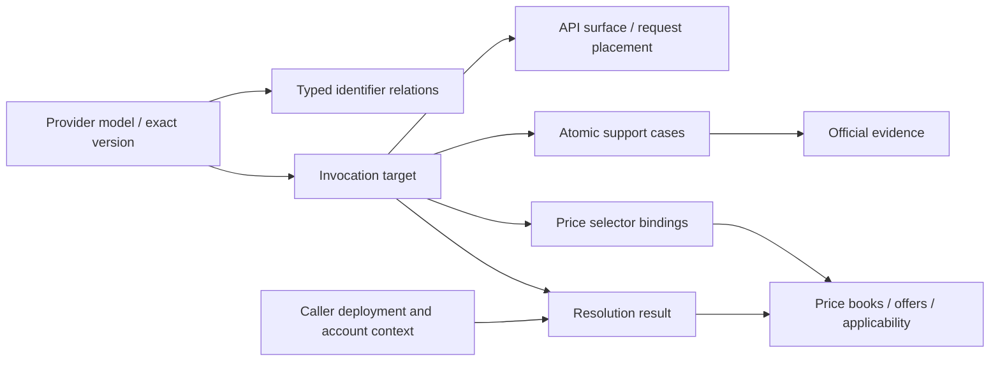

# Catalog schema upgrade: model identity, invocation targets, and price applicability

Status: implementation in progress — v2 is not published or adopted in stored data

This proposal covers the 20 registered providers. Provider-owned documentation establishes the
meaning of identifiers, invocation conditions, and pricing selectors. Reviewed adapters then
collect and update those facts deterministically.

The existing contracts remain defined by [Catalog semantics](catalog.md),
[Invocation addressing](invocation-addressing.md), and [Pricing](pricing.md).
The internal invocation schema, reference validator, identity helpers, case resolver, TypeSafe source
facts, collection retention, canonical persistence, and the initial v2 catalog/pricing publication
path are implemented. The v2 calculation export, provider partitions, coverage, and source-level
reader/evaluator are implemented. Package 1.0.0 uses the v2 entry and retains an explicit v1 entry;
registry publication is a separate release step.
Caller resource confirmation, lifecycle/capability selection policy, request addressing templates,
and deferred website invocation data are implemented. The website supports explicit target/case
selection, scoped diagnostics, request templates and conditional price inputs. Migration of the
remaining providers is pending. The full contract
below is the implementation target. Durable
data has not been refreshed; the checked-in publication still uses the existing contracts.
The current v2 publisher shares validated legacy books. A binding selector must already occur in
each linked offer's commercial applicability, except for model identity restricted by the book or
offer scope. A binding-only restriction rejects the candidate before publication, preserving the
previous accepted pair. Candidate preparation uses bounded canonical encoding and shares already
validated price books. Full publication and recovery have been exercised on the stored catalog with
a 4 GiB JavaScript heap; complete asset generation exceeds a 2 GiB heap in both v1 and v2. The
compressed export pack permits 64 MiB for the two complete versioned trees, while existing UI and
per-resource decoded limits remain unchanged.

## 1. Recommended decision

Keep `(provider_id, model_id, version)` and the existing `uid` as catalog identity.
Neither promises that its value can be sent directly in an inference request. Add top-level
`invocation_targets` describing which request identifier an API surface accepts, for which
model identity, and under which documented conditions.

Represent catalog identifiers, name aliases, request addresses, upstream provider identifiers,
and caller-created deployment names separately. A target describes an invocation mechanism;
it is not an account resource or a successful request.

The recommended name is `invocation_targets`. It accommodates inference profiles, deployment
address templates, local runtime requirements, and addresses with explicit negative evidence.
`inference_targets` is also plausible, but may be confused with an execution backend or a
provider field such as SageMaker's `TargetModel`.

Prices remain in separate price books. Targets supply evidence-backed selector bindings without
duplicating rates or inferring prices from identifier spelling. Two request identifiers for one
model may select different tariffs. One request identifier may also have different tariffs by
API, source region, service tier, or actual backend.

Catalog semantics are provider-neutral. Schema decisions follow provider facts and Kmodels'
collection, publication, selection, and pricing requirements. Provider-owned contracts define
identifier meanings, invocation support, regional scope, and price applicability. Research,
deterministic synchronization, public exports, and UI presentation use that same evidence boundary.

This proposal preserves static deployment and the existing provider boundary. It does not introduce
a global cross-provider base-model registry, account-resource discovery, credential collection, or
inference calls. Identity resolution, documented support, account accessibility, and successful
request execution remain separate conclusions.

## 2. Current contract and evidence

### 2.1 Source and publication baseline

The evidence below was inspected on 2026-10-30. Times use Asia/Shanghai. These are fixed research
snapshots, not assertions about the latest deployment.

| Object                      | Observed baseline                                                                                                                                    |
| --------------------------- | ---------------------------------------------------------------------------------------------------------------------------------------------------- |
| Local source HEAD           | `b0ed6af83ac50c422b121b7c63f9ce04a4f4b0bd`                                                                                                           |
| Local catalog               | 4,352 exact rows; generated at 09:46:26; version `5c0956f1d3e3194d8cec2a85e7132c056aaf65ab8daa8f6f87f9b8756b6ca186`                                  |
| Published audit catalog     | 4,332 exact rows; generated at 10:04:28; version `63a7547f2a539cb604edc0dcc3f6225855e11999f491f40b5be95cd7e8e30de5`                                  |
| Published semantic profiles | `ids`, `identifiers`, `summary`, and `models` use schema version 1 and the same published catalog version                                            |
| Published audit envelope    | `/catalog/index.json` has no schema version field                                                                                                    |
| Website-linked refresh      | [Run 40989459100](https://github.com/Justineo/kmodels/actions/runs/40989459100), with GitHub API head SHA `f41e09e687cda81f16b3dca5b80d29506a99df43` |

The website refresh link is derived from the last commit affecting `data/catalog.json` in
`vite.config.ts`. It is not an attestation of the complete deployed source tree. The local
working tree also contained independent changes, so its behavior cannot be attributed solely
to HEAD.

All four downloaded v1 semantic profiles passed the local Zod schemas. Rebuilding them with local
`publication.ts` from the published audit envelope produced structurally identical results.
This establishes publication-contract compatibility, not equality of collector implementations.

| Profile       | Response-body SHA-256                                              |
| ------------- | ------------------------------------------------------------------ |
| `models`      | `e6d5ddb964fa0c765690ded7e14f31780decbe624926c8784dc81f1cde232acf` |
| `identifiers` | `e12a41497a73e540c40e260af94117aa0b9d9e6a9bdb12248a7a42f58ad97e9b` |
| `ids`         | `5f004337349f3c68124f1bbf09d312c24b530bb40cc8f3c81296b8fe426914d9` |
| `summary`     | `576bce5c8645e732bb9dcfcbbbada0c5ae838c9f87fa3e69838fa34f34cd9d9d` |
| `index`       | `b5c4b5e46657f65c177f0e92d6487e32c0c10a2b941d9ccc007ce162346e7360` |

### 2.2 Source-to-consumer flow

| Layer                     | Current behavior                                                                                                                        | Required contract change                                                                                                                         |
| ------------------------- | --------------------------------------------------------------------------------------------------------------------------------------- | ------------------------------------------------------------------------------------------------------------------------------------------------ |
| Registration and fetching | `manifests.ts` declares providers, sources, field ownership, and scope; `fetch.ts` bounds acquisition; `adapters.ts` dispatches parsing | Declare ownership of identity, surface, target, support, and price-selector facts separately; API documentation cannot expand catalog membership |
| Parsing                   | Provider parsers return `SourceParseResult`; `baseModel()` defaults to `id_kind: api_id`                                                | The default is not invocation evidence; return target facts independently of aliases                                                             |
| Normalization and merging | `collector.ts` normalizes tasks and delivery, then unions aliases, endpoints, and availability independently                            | Merge conditioned facts atomically; never construct support through a Cartesian product                                                          |
| Validation and retention  | `validation.ts`, `collectProvider()`, and source-owned retention                                                                        | Validate reference closure, condition conflicts, negative evidence, and freshness; retained facts keep their original observation times          |
| Persistence               | Collection composes, prepares, and commits the catalog/pricing pair                                                                     | Invocation semantics participate in catalog content identity; keep catalog-to-pricing dependencies acyclic                                       |
| Public exports            | `publication-schema.ts`, `publication.ts`, `endpoints.ts`                                                                               | Preserve v1 and add typed identifier and invocation projections                                                                                  |
| Static distribution       | `projections.ts` produces asset packs; `published-assets.ts` validates and materializes them                                            | Publish references from one accepted pair and one publication tree                                                                               |
| Website                   | `website-data.ts`, `website-schema.ts`, `website-runtime.ts`, model and pricing detail components                                       | Replace disconnected invocation hints with a selected target and its price conditions                                                            |
| Pricing consumers         | Existing price schema, pricing inputs, website queries, and portable calculator                                                         | Add explicit target-to-selector bindings while reusing the existing evaluator                                                                    |

`ProviderModel.routes` currently contains only
`{source_ref, provider, provider_model_id, task, status: live}`.
It preserves routing evidence without a complete request contract.
The `deployment` field in `model-metadata.ts` describes package configurations, not account
deployments. The semantic model publication omits routes, account availability, and source
references, so consumers cannot recover route-specific invocation claims from that profile.

### 2.3 Reproduced gap: Bedrock GLM 5.3

Both inspected catalogs identify the model as `amazon-bedrock/zai.glm-5.3`, with
`id_kind=api_id` and aliases `global.zai.glm-5.3` and `us.zai.glm-5.3`.
API endpoints and positive region/deployment tuples are separate model-level fields.

`bedrock.ts::programmaticAccess()` places profile IDs into aliases and initially includes
the in-region deployment type. The regional-table filter leaves this model without a positive
in-region availability tuple, but the explicit negative claim about its bare ID is not retained.
This is missing semantics, not evidence that the publication explicitly promises direct invocation.

The [AWS GLM 5.3 card](https://docs.aws.amazon.com/bedrock/latest/userguide/model-card-zai-glm-5-3.html)
requires cross-region profiles, lists runtime support and mantle non-support, distinguishes US
and global source-region availability, and restricts access to eligible customers. The regional
table's yes/no icons were checked as well as its text.

One model identity therefore has multiple conditional request addresses. The bare identity does
not supply another valid request address, and the two profiles do not create two model identities.

## 3. Provider contracts and deterministic synchronization

The following review covers all 20 registered providers using repository guides, registered
sources, and representative first-party contracts. It establishes provider mechanisms, not every
model's current support matrix. Each emitted target still requires exact model evidence.

| Provider           | Verified official meaning                                                                                                                                                                                                                                                        | Adapter and pricing boundary                                                                                                                                                                                                                                                     |
| ------------------ | -------------------------------------------------------------------------------------------------------------------------------------------------------------------------------------------------------------------------------------------------------------------------------- | -------------------------------------------------------------------------------------------------------------------------------------------------------------------------------------------------------------------------------------------------------------------------------- |
| `typesafe`         | [System One](https://docs.typesafe.ai/api/system-one.md) accepts a model name or alias; the response model may differ from the requested alias                                                                                                                                   | Join model documentation and inventory; bind System One separately from Chat. Preserve requested alias and resolved model separately; price only the documented model/operation scope                                                                                            |
| `openai`           | The [GPT-4.1 card](https://developers.openai.com/api/docs/models/gpt-4.1.md) distinguishes Model ID, default snapshot, snapshots, endpoints, and lifecycle; this inspected card was deprecated                                                                                   | Establish relations from exact cards, not date or suffix spelling. API and regional-processing support require separate evidence; snapshots do not automatically inherit alias tariffs                                                                                           |
| `anthropic`        | The [ID/version contract](https://platform.claude.com/docs/en/about-claude/models/model-ids-and-versions) defines dateless IDs from generation 4.6 as pinned snapshots; older short aliases can resolve to newer dated snapshots                                                 | Preserve documented pinned/rolling behavior. Do not merge direct, Bedrock, and Google identities; fast and regional processing remain scoped invocation and price facts                                                                                                          |
| `amazon-bedrock`   | [Converse](https://docs.aws.amazon.com/bedrock/latest/APIReference/API_runtime_Converse.html) accepts foundation-model IDs or inference profiles; model cards determine which are supported                                                                                      | Preserve endpoint, ID role, API, source region, and inference mode together. Public system profiles are literals; application profiles are caller resources. See section 6 for pricing                                                                                           |
| `amazon-sagemaker` | [InvokeEndpoint](https://docs.aws.amazon.com/sagemaker/latest/APIReference/API_runtime_InvokeEndpoint.html) requires the configured EndpointName, with additional selectors for multi-model or component serving                                                                 | JumpStart IDs select products/deployment packages, not invocation endpoints. Package revisions are not model versions. Publish deployment requirements; keep account bindings private and capacity charges separate from token rates                                             |
| `azure`            | [Azure OpenAI](https://learn.microsoft.com/en-us/azure/foundry-classic/openai/how-to/switching-endpoints) requires a deployment name even when the request field is named model                                                                                                  | Model/version selects what is deployed. Origin, deployment name, type, and region come from caller configuration. Other Foundry surfaces require their own contracts; price exact version, deployment type, and region                                                           |
| `vertex`           | The [partner MaaS guide](https://docs.cloud.google.com/gemini-enterprise-agent-platform/models/partner-models/use-partner-models) distinguishes project/location/publisher/model paths and regional, global, and multi-region endpoints                                          | Separate Google, partner, open MaaS, and deployed endpoints. Keep exact methods such as generateContent, rawPredict, and predictLongRunning; deployed endpoint IDs require caller bindings                                                                                       |
| `huggingface`      | [Inference Providers](https://huggingface.co/docs/inference-providers/en/index) distinguishes Hub IDs, native provider IDs, router provider suffixes, and automatic routing policies                                                                                             | Combine exact live mappings with the relevant wire contract. An automatic policy does not establish one backend tariff. A downloadable repository does not establish a hosted route                                                                                              |
| `ollama`           | The [quickstart](https://docs.ollama.com/quickstart) separates local and cloud use; [tags](https://docs.ollama.com/api/tags) lists models available on a particular daemon                                                                                                       | Keep Library families, exact tags, and installed names distinct. Local use requires runtime and installation evidence; cloud uses a separate surface. Only public cloud invocation rates belong in its price book                                                                |
| `llama`            | Meta's [SKU registry](https://github.com/meta-llama/llama-models/blob/main/models/sku_list.py) resolves descriptors and Hugging Face repository references                                                                                                                       | These are publisher/artifact identities, not universal hosted addresses. Without deployment evidence there is no target; do not inherit routes, prices, or access from other providers                                                                                           |
| `databricks`       | [Foundation Model APIs](https://docs.databricks.com/aws/en/machine-learning/foundation-model-apis/api-reference) exposes preconfigured workspace endpoints and separately created provisioned endpoints, which may serve multiple models                                         | Published default endpoint names may be literals, but workspace origin remains caller input. Custom endpoints need model bindings. Task formats and capacity pricing remain separate                                                                                             |
| `vercel`           | [Models and providers](https://vercel.com/docs/ai-gateway/models-and-providers) separates gateway IDs from provider routing; public inventory is distinct from team eligibility                                                                                                  | Preserve exact backend route prices. Fast slugs, region, fallback, and served tier remain separate. [Regional routing](https://vercel.com/docs/ai-gateway/security-and-compliance/regional-inference) metadata establishes served conditions; requested preferences alone do not |
| `gemini`           | The [Models resource](https://ai.google.dev/api/models?hl=en) distinguishes name, baseModelId, version, and supportedGenerationMethods                                                                                                                                           | Map REST resource names and SDK short names through the wire contract. Do not globally strip prefixes or treat every method as generateContent. Gemini API and Vertex remain different providers and price books                                                                 |
| `cohere`           | [v2 Chat](https://docs.cohere.com/v2/reference/chat) requires the name of a model compatible with that API                                                                                                                                                                       | Join exact model/task evidence to endpoints; Chat, Embed, and Rerank support do not imply one another. Retain operation-specific meters and price conditions                                                                                                                     |
| `mistral`          | [Chat](https://docs.mistral.ai/api/endpoint/chat) uses model IDs; [regional inference](https://docs.mistral.ai/inference/regional-inference) requires checking model availability against the selected regional endpoint                                                         | Separate API names from weights-only products and global/EU/US surfaces. Regional feature exclusions are explicit. Regional price uplifts cannot establish model availability                                                                                                    |
| `xai`              | [Responses](https://docs.x.ai/developers/rest-api-reference/inference/responses#responses) places the model in the request body; Responses and Chat Completions have separate references                                                                                         | Bind exact catalog/card models to operations. Different IDs in sample requests and responses do not establish aliases. Tool charges remain separate; new APIs require reviewed companions and fixtures                                                                           |
| `dashscope`        | [Compatible interfaces](https://www.alibabacloud.com/help/en/model-studio/compatibility-of-openai-with-dashscope) specify model and origin; [regional access](https://www.alibabacloud.com/help/en/model-studio/get-api-key) separates regional endpoints, keys, and inventories | Separate regions, workspaces, native/compatible APIs, and asynchronous media. Do not convert prices across currencies. An inspected Beijing-labelled example used an ap-southeast-1 hostname: retain the conflict rather than generate a Beijing route                           |
| `deepseek`         | The [entry guide](https://api-docs.deepseek.com/) and [pricing page](https://api-docs.deepseek.com/quick_start/pricing/) explicitly retain legacy request IDs while redirecting to a newer model and its Flash tariff                                                            | Retired underlying products and accepted addresses can coexist. Preserve redirects and observed resolution rather than treating names as interchangeable snapshots. Peak/off-peak conditions are independent                                                                     |
| `kimi`             | [International](https://platform.kimi.ai/docs/openapi.json) and [China](https://platform.kimi.com/docs/openapi.json) OpenAPI servers use different origins and publish operation-specific model scopes                                                                           | Admit exact model/region/API tuples. Do not strip highspeed suffixes. Origin selects regional pricing and currency; one region's contract cannot fill another region's missing evidence                                                                                          |
| `cerebras`         | [Chat Completions](https://inference-docs.cerebras.ai/api-reference/chat-completions) requires a model ID and documents operation-specific parameters                                                                                                                            | Join the public model inventory and lifecycle sources to the exact API. Do not generalize Chat support to other operations or treat inventory presence as account entitlement                                                                                                    |

Remaining evidence boundaries are specific: per-model regional Mistral inventory; non-OpenAI Azure
surface addressing; private Vertex deployment bindings; the conflicting DashScope region example;
and future resolutions of dynamic aliases. These require an identified source or caller context.
They remain unknown without blocking independently established facts.

## 4. Entities and field ownership



### 4.1 Model facts

- Keep identity, independent version, display name, description, model-card metadata, and package
  deployment metadata. Treat `uid` as opaque; consumers must not split it on slashes or at signs.
- Replace ambiguous identifier-kind semantics with typed relations in v2. Historical
  `id_kind: api_id` is insufficient to create a literal invocation target.
- Model-level tasks and modalities support discovery. Existing capabilities and limits are
  descriptive until their scope is established; mark unresolved legacy scope as
  `legacy_unscoped`. Invocation selection must not inherit those values automatically.
- Preserve product lifecycle and release stage separately from target lifecycle. A redirected
  address can remain usable after its original product retires; cloud retirement need not retire
  a local artifact.
- Keep documented upstream relationships as metadata. Do not merge identities based on names,
  suffixes, provider ownership, or presumed shared weights.

An exact catalog tuple does not necessarily identify immutable weights. Independently published
snapshot IDs retain independent rows under existing admission rules, with directed relations to
series or rolling names. Do not extract a snapshot date into `version` without an independently
published version field. Repairing historical snapshot aliases requires provider evidence and a
separate stored-data operation. A pinned address guarantee does not make a series UID a weight hash.

### 4.2 Identifier relationships

1. **Identity relations** connect provider catalog IDs, official alternate names, and snapshot or
   rolling-alias resolutions. Preserve one-to-many relationships and observation times.
2. **Request addresses** are literals accepted by a specific surface or values supplied by the
   caller. A Bedrock profile can be indexed for identity lookup without being interchangeable
   with the bare model ID in requests.
3. **Upstream references** retain their namespace and role, such as an HF backend ID or publisher
   repository. They do not create another provider's invocation target.

Display names are not exact identifiers. An old alias whose role is not established becomes an
`unclassified` lookup edge, never an inferred invocation target.

### 4.3 Proposed TypeScript shape

This sketch reuses the existing task, lifecycle, capability, and pricing vocabularies. Implementation
must use strict Zod unions, bounded strings, and reference validation. It does not introduce a
general-purpose condition language.

```ts
type SupportState = "supported" | "unsupported" | "unknown" | "conflicting";
type ScopeValue =
  | { kind: "exact"; value: string }
  | { kind: "any" }
  | { kind: "not_applicable" }
  | { kind: "unknown" };

interface SupportClaim {
  state: SupportState;
  evidence_refs: string[];
  reason?: "not_collected" | "not_published" | "source_unavailable" | "ambiguous";
}

interface InvocationEvidence {
  id: string;
  source_ref: string;
  document_url: string;
  locator: string;
  content_hash: string;
  observed_at: string;
  basis: "official_catalog" | "official_api_contract" | "official_documentation";
}

interface ApiSurface {
  id: string;
  provider_id: string;
  endpoint_family: string;
  api: string;
  transport: "http" | "websocket";
  method: "GET" | "POST";
  origin_template: string;
  path_template: string;
  identifier_location:
    | { kind: "body"; pointer: string }
    | { kind: "path"; parameter: string }
    | { kind: "query"; parameter: string };
  inputs: Array<{
    name: string;
    role: "origin" | "project" | "region" | "workspace" | "api_version";
  }>;
  evidence_refs: string[];
}

type Address = { kind: "literal"; value: string } | { kind: "caller"; input: string };

interface InvocationCase {
  id: string;
  task: ModelTask;
  request_region: ScopeValue;
  inference_mode: ScopeValue;
  inference_geo: ScopeValue;
  deployment_type: ScopeValue;
  support: SupportClaim;
  requirements: Array<{
    kind:
      | "authentication"
      | "customer_eligibility"
      | "model_access"
      | "deployment_binding"
      | "installation"
      | "runtime_compatibility";
    evidence_refs: string[];
  }>;
  // Only facts explicitly applicable to this case; missing facts remain unknown.
  fact_refs: string[];
}

interface InvocationTarget {
  id: string;
  model_ref: string;
  surface_ref: string;
  address: Address;
  address_role: "model" | "inference_profile" | "deployment" | "endpoint" | "local_tag";
  resolution: "pinned" | "rolling" | "redirect" | "configured" | "unknown";
  resolved_model_ref?: string;
  // An upstream identifier is not automatically valid in this surface's request.
  upstream?: { namespace: string; model_id: string };
  routing?: { kind: "fixed" | "automatic"; provider?: string; policy?: string };
  // Additional selectors, such as SageMaker multi-model or component selectors.
  selectors: Array<{
    location: { kind: "header" | "body" | "path" | "query"; key: string };
    value: Address;
  }>;
  lifecycle: ModelLifecycle;
  release_stage: ModelReleaseStage;
  cases: InvocationCase[];
  evidence_refs: string[];
}

interface IdentifierRelation {
  provider_id: string;
  value: string;
  role: "catalog_id" | "name_alias" | "request_id" | "unclassified";
  model_ref: string;
  target_refs: string[];
  evidence_refs: string[];
}
```

The v2 audit envelope declares `schema_version: 2`. Its data includes models, surfaces,
invocation targets, identifier relations, scoped facts, invocation evidence, and target coverage,
alongside providers, sources, and collection coverage. The invocation profile projects the subset
needed for addressing and retains the same catalog version.

Each identifier edge points to one model. Preserve all edges for a repeated value.
A request-ID edge requires target references; other roles may have none.

A surface is a reusable provider wire contract, not an inventory of account endpoints.
Templates accept only declared inputs and identifier parameters. Encode path segments without
executing expressions or remote code. Protocol/version requirements belong to the reviewed
surface contract; credentials never enter the public schema.

Each target fixes one model, surface, and primary address. Each case fixes one task and a joint
scope. Multiple APIs produce multiple targets that share references rather than duplicating model
facts or prices. Regions may be grouped for display, but independent arrays must not generate
support combinations. `any` requires explicit evidence; `unknown` is not a wildcard.

Scoped facts use `{id, model_ref, field, value, evidence_refs}`. Field and value form a strict
union over supported capability and limit fields. Cases explicitly reference applicable facts.
Reuse a fact across cases only when its source establishes that scope; model summaries do not
backfill the fact table.

`target_coverage` records `not_collected | partial | complete` for a model and, where known,
surface. Complete coverage requires a reviewed closed domain and evidence. It describes acquisition
coverage, not universal support. Source-level exhaustiveness does not establish a complete matrix
of every API and region.

### 4.4 Evidence and runtime observations

| Dimension          | Public catalog                                                         | Caller-owned context                                                             |
| ------------------ | ---------------------------------------------------------------------- | -------------------------------------------------------------------------------- |
| Documented support | Supported, unsupported, unknown, or conflicting for an exact case      | References the catalog claim                                                     |
| Collection state   | Coverage, freshness, observation time, and retained evidence           | May apply a maximum evidence age                                                 |
| Account access     | Public eligibility requirements; actual account access remains unknown | Accessible, inaccessible, or unknown, scoped and timestamped                     |
| Resource binding   | Input requirements and required model/version relationship             | Deployment, endpoint, or installed tag mapped to an exact model                  |
| Request execution  | No runtime verification claim                                          | Not tested, succeeded, or failed, with target, context, time, and error category |

An authorization, quota, capacity, or transient failure does not establish global non-support.
One successful request does not prove support for another account, region, or API. Any future
runtime validation belongs in a separately authorized, private observation store.

Contradictory official evidence for the same scope remains conflicting unless an explicit authority
rule resolves it. Negative evidence applies only to its scope. Restrictions on new deployments do
not prove existing deployments stopped serving. Observation time and effective time remain
separate; imprecise retirement dates do not trigger inferred lifecycle transitions.

## 5. Examples and invocation selection

### 5.1 Bedrock GLM 5.3

The current projection, abbreviated:

```json
{
  "model_id": "zai.glm-5.3",
  "id_kind": "api_id",
  "aliases": ["global.zai.glm-5.3", "us.zai.glm-5.3"],
  "api_endpoints": [{ "name": "Converse", "path": "model/{modelId}/converse" }],
  "availability": [{ "region": "us-east-1", "deployment_type": "bedrock-runtime/geo" }]
}
```

Retain one model identity. Its Converse surface uses the runtime origin and
`POST /model/{modelId}/converse`, placing the identifier in the path parameter.
The following table summarizes proposed records; complete records also carry evidence,
requirements, and fact references.

| Address              | Surface          | Source region                                            | Inference mode             | Support                                  |
| -------------------- | ---------------- | -------------------------------------------------------- | -------------------------- | ---------------------------------------- |
| `us.zai.glm-5.3`     | Runtime Converse | `us-east-1`                                              | US geographic cross-region | Supported; customer eligibility required |
| Same                 | Runtime Converse | Separate cases for `us-east-2`, `us-west-1`, `us-west-2` | Same                       | Supported                                |
| Same                 | Runtime Converse | `ca-central-1`                                           | US geographic cross-region | Unsupported by an explicit negative cell |
| `global.zai.glm-5.3` | Runtime Converse | Each source region explicitly listed in the card         | Global cross-region        | Supported; customer eligibility required |
| `zai.glm-5.3`        | Runtime Converse | Any, for this explicit in-region prohibition only        | In-region                  | Unsupported by explicit documentation    |

Create separate surfaces and targets for the other documented APIs, retaining the evidence that
connects them to the programmatic-access table. Preserve explicit mantle non-support independently.
Do not invent an EU profile. Application-profile targets require model-specific support evidence
and caller-supplied addresses; public data does not enumerate account ARNs.

### 5.2 Other provider mechanisms

| Example                                   | Current ambiguity                                                    | Proposed behavior                                                                                                                                                                               |
| ----------------------------------------- | -------------------------------------------------------------------- | ----------------------------------------------------------------------------------------------------------------------------------------------------------------------------------------------- |
| Azure `gpt-4o@2024-05-13`                 | Catalog model/version is not a deployment name                       | Keep the identity; require caller deployment name, origin, and exact-version binding. Missing configuration is not model absence. This historical example does not assert current deployability |
| Vertex `gemini-2.5-flash`                 | A short ID does not identify project, location, publisher, or method | Bind the literal model token to the Google generateContent surface and require project/location. Partner rawPredict uses a different surface; lifecycle is checked independently                |
| SageMaker `ai21-contextual-answers`       | API-like catalog ID versus actual EndpointName                       | Preserve JumpStart identity and package revision separately; require endpoint binding and any multi-model/component selectors                                                                   |
| HF `openai/gpt-oss-120b` through Cerebras | Backend ID `gpt-oss-120b` is not the router's request ID             | With exact live mapping and chat-contract evidence, use `openai/gpt-oss-120b:cerebras` for the fixed route; preserve the native ID as upstream metadata. An automatic-policy target is separate |
| Ollama `gemma3`                           | Library family does not prove an installed tag                       | Require runtime and installed-tag binding for local use; create cloud targets only from exact cloud evidence. Do not manufacture tags                                                           |
| DeepSeek legacy ID                        | Product retirement can be mistaken for address retirement            | Preserve a redirect target. Set resolved_model_ref only when the exact destination identity is established; apply the documented redirect tariff rather than inheriting the old product's price |

### 5.3 Selection algorithm

Selection takes a catalog version, provider, task, and API/surface. Optional context includes
region, deployment, runtime, release-stage policy, and required capabilities. Return independent
results rather than one callable boolean:

```ts
interface InvocationResolution {
  model_refs: string[];
  target_ref?: string;
  case_ref?: string;
  identity: "unique" | "ambiguous" | "not_found";
  context_match: "matched" | "incomplete" | "unknown" | "mismatched";
  documented_support: SupportState;
  configuration: "complete" | "needs_configuration" | "conflicting";
  account_access: "accessible" | "inaccessible" | "unknown";
  request_verification: "not_tested" | "succeeded" | "failed";
  missing_inputs: string[];
  evidence_refs: string[];
}
```

1. Resolve identifiers exactly within a provider, retaining all model references. Do not fold case,
   strip arbitrary prefixes, or select the first version. Preserve both identity and request edges
   when a value has both roles.
2. Resolve targets for the requested surface and task before filtering by support state. Compare
   each case against supplied context only. A contradictory known value is mismatched; a missing
   caller value needed to select an exact scope is incomplete, not mismatched. Missing catalog
   scope evidence is unknown and cannot be repaired merely by supplying caller configuration.
   Retain compatible incomplete cases, including the supported regional choices for an address
   whose source region has not yet been selected.
3. Return a result per case, preserving its documented support independently of context matching
   and configuration completeness. Unsupported and conflicting cases remain diagnostic results,
   not candidates for request generation. Supported incomplete cases are selectable options with
   missing inputs, not assertions that the current request is supported. Evaluate overlapping
   positive and negative claims under the evidence conflict rules; never pick a positive case to
   bypass an unresolved contradiction. If identity exists but no documented case covers the
   supplied context, return unknown unless explicit negative or closed-domain evidence proves
   otherwise. An explicitly requested target with contradictory configuration returns a mismatch
   diagnostic rather than silently disappearing.
4. Apply target lifecycle and caller policy. Retired product identity does not automatically
   invalidate an explicitly supported redirect. Distinguish new and existing deployments where
   the provider does; unknown release stage does not mean GA.
5. Evaluate capabilities and limits only from applicable case facts. Derive the selectable-options
   view from supported matched or incomplete cases, without discarding the other diagnostic
   results. Generate a request candidate only when context is matched, documented support is
   supported, and all required request inputs are complete and consistent. Literal addresses may
   still need region or project configuration; never substitute a catalog ID for a deployment name.
   Complete configuration does not resolve unknown account access. Label generated candidates
   with unverified account access accordingly.
6. Keep request-time alias resolution in caller context. A result conflicting with a pinned contract
   is a diagnostic, not permission to silently rewrite identity or price.

The result is a collection of case assessments, not one target-wide boolean or a union of their
scopes. The UI may group alternatives while retaining their case references and required inputs.
Here, documented support always describes the case's declared scope; context_match describes
whether that scope has been established for the caller's selection.

| Input                                              | Resolution behavior                                                                                                                     |
| -------------------------------------------------- | --------------------------------------------------------------------------------------------------------------------------------------- |
| US GLM profile, region omitted                     | Keep each supported US-region case with incomplete context and request_region missing; show region choices without generating a request |
| US GLM profile, us-east-1 supplied                 | The corresponding positive case matches; other source-region cases mismatch; remaining account requirements stay unverified             |
| US GLM profile, ca-central-1 supplied              | The explicit negative case matches and reports unsupported; do not offer a request candidate                                            |
| Exact scope with contradictory official support    | Report conflicting support and both evidence sets; no request candidate                                                                 |
| Region supplied but no applicable catalog evidence | Report unknown support, not unsupported, even if request inputs are otherwise complete                                                  |
| Azure target without deployment name               | Retain the applicable option with needs_configuration and deployment_name missing                                                       |

## 6. Identifier scope and pricing

### 6.1 Regional identifiers can affect prices

A profile's region-like prefix can select a tariff, but does not necessarily determine the whole
price. The [AWS cross-region guide](https://docs.aws.amazon.com/bedrock/latest/userguide/cross-region-inference.html)
distinguishes routing geography from source region and describes source-region pricing.
Geographic and global profiles may have different tariffs. General savings descriptions cannot
replace an exact model rate.

The existing Bedrock adapter already emits conditions including deployment scope, inference
geography, endpoint, and region. The missing contract is an explicit, public connection between
those conditions and the invocation target.

In the inspected local pricing snapshot, Kimi K3 has a conditional global-cross-region/runtime/
standard offer, while GLM 5.3 has no price book. Consequently the GLM examples contain no numeric
quote and borrow no price from another model. The inspected pricing version was
`7dcd9bbf20707ad45cc19d51356da4ed3df472e9c9b3c58946b977b098775fc0`,
bound to the local catalog in section 2. This does not establish published pricing parity.

| Concept                     | Example                                                | Established by request ID alone?                                             |
| --------------------------- | ------------------------------------------------------ | ---------------------------------------------------------------------------- |
| Routing scope/geography     | US geographic or global cross-region                   | Only through an exact official profile mapping                               |
| Request/source region       | Runtime origin in `us-east-1`                          | Usually not; a US profile has multiple source regions                        |
| Execution region            | Region that actually processed a request               | No; requires an applicable response/log contract                             |
| Billing-region selector     | Source region or another product-defined tariff region | Requires evidence identifying which geographic dimension determines the rate |
| Backend, served tier, speed | Final provider, priority tier, fast serving            | Not when routing or fallback is dynamic                                      |

The same principle applies to Mistral regional origins, Kimi international/China origins, and Vercel
regional/backend selection. A DeepSeek redirect can change the served model and tariff without
changing the requested ID. A normalized string with removed prefixes or suffixes is not a pricing key.

### 6.2 Acyclic publication and selector bindings

The catalog owns invocation facts and does not reference price-offer hashes. Only the new v2
pricing envelope adds invocation bindings, under data.invocation_bindings, and references the
accepted v2 catalog. The legacy pricing envelope remains unchanged. Section 7.1 defines the
separate paths, projections, and content bindings. Existing books, offers, terms, and applicability
remain the sole source of amounts.

```ts
interface InvocationPricingBinding {
  target_ref: string;
  case_ref: string;
  offer_refs: string[];
  selectors: Array<{
    dimension: PriceDimension;
    value:
      | { kind: "fixed"; value: PriceCategoricalValue }
      | { kind: "context"; input: string }
      | { kind: "observed"; input_ref: string };
    evidence_refs: string[];
  }>;
  evidence_refs: string[];
}
```

Context inputs are bounded, typed request or deployment fields, not arbitrary expressions.
Observed inputs reference the existing pricing-input acquisition contracts. Noncategorical inputs
continue to use the existing price-input types. Offer references narrow the candidate set; they
do not make every variant in an offer applicable. Evaluate the complete applicability expression.

Without an exact commercial join, omit the binding and report that pricing has not been linked.
Do not select a model's first price book.

For the US GLM profile, invocation evidence establishes geographic cross-region mode and US
routing geography. Once an exact tariff is admitted, a binding can fix deployment scope and
runtime endpoint, derive operation from the selected API, and bind request region to price region
where the billing contract establishes that relationship. The profile does not determine service
tier. A global-profile binding instead fixes global scope without assigning US inference geography.
No GLM offer reference should be invented before a corresponding price book exists.

Reject conflicts between target-fixed selectors and caller inputs. Keep requested and served
contexts separate for automatic routing. Before execution, show conditional quotes; after execution,
use documented response/log selectors where available. Fallback must not retain the original
provider's tariff. Cache TTL, modality, tools, time windows, and other independent billing conditions
remain necessary even when the main model ID matches.

Bindings participate in accepted-pair validation. Retained prices may retain a binding only while
target references and selector semantics remain compatible. Do not join old alias resolution or
region mappings to new targets. Binding evidence and price observations must both remain
resolvable. Pricing and calculator contracts require their own version changes.

### 6.3 UI behavior

Count models by catalog identity. Details distinguish model information, invocation options, and
pricing. Keep the model ID copyable as a catalog identifier. After target selection, label the
request identifier for its specific API and show endpoint, source region, routing mode, lifecycle,
eligibility requirements, and evidence date.

Illustrative GLM detail state:

```text
GLM 5.3                         Catalog ID: zai.glm-5.3
Invocation   [ US geographic profile ]  [ Converse ]
Request ID   us.zai.glm-5.3                              [Copy]
Source region [ us-east-1 ]
Routing      US cross-region        Account eligibility: unverified
Documentation: supported            Request verification: not tested

Price scope  runtime / geo cross-region / US / us-east-1
Service tier [ Select, or apply a documented API default ]
Quote        No public price binding for this target in this snapshot
```

Switching to a global target updates routing scope, allowed source regions, and fixed price
conditions. Clear selections that become invalid and explain why; do not silently select the first
region. Global routing does not mean the target accepts calls from every source region.
Show the bare ID's explicit non-support as an addressing note, not as a default request choice.

Display fixed price conditions as read-only values and missing necessary conditions as selectors.
Show exact input, cache, output, and other rates only with their units, currency, and applicability.
For multiple conditional quotes, show a scoped table rather than a minimum price or input/output
rates assembled from different routes. Automatic routing keeps the final provider/region unresolved
until applicable response evidence is available. Equal rates may share a display row while retaining
their scopes. Missing pricing does not hide documented invocation candidates.

List summaries may link to multiple conditional quotes. Selection and cost calculations must use
the same target/context. Any range is explicitly a range over the displayed candidates, not an
actual request cost. Exports retain target/case references, catalog/pricing versions, fixed and
selected conditions, missing inputs, and quote references. Public exports exclude caller resources
and credentials.

## 7. Publication contracts

Publish new contracts under `/catalog/v2/`, `/providers/v2/`, and `/pricing/v2/` while preserving
the existing paths and their exact schemas. Do not change field semantics in place for unknown
consumers. An unchanged URL alone is not a compatibility guarantee.

| Profile                  | v1 compatibility                                              | v2 contract                                                                                                       |
| ------------------------ | ------------------------------------------------------------- | ----------------------------------------------------------------------------------------------------------------- |
| `ids`                    | Distinct model-ID inventory                                   | Remains identity inventory; does not include invocation addresses or imply callability                            |
| `identifiers`            | Existing model_id/alias edges, including one-to-many mappings | Typed edges with model references; request-ID edges also reference targets whose conditions remain applicable     |
| `summary`                | Exact version, status, and tasks                              | May add target coverage; no targets does not imply non-support                                                    |
| `models`                 | Existing groups and variants                                  | Add target and scoped-fact references without embedding duplicate target documents                                |
| `invocations`            | New profile                                                   | Surfaces, targets, support cases, coverage, and sufficient evidence references for documented candidate selection |
| Audit `index`            | Existing envelope                                             | Explicit schema version, complete facts, sources, diagnostics, and precise evidence locators                      |
| Provider metadata/models | Existing provider projections                                 | Provider-scoped invocation endpoints with closed references and no private inventory                              |
| UI profiles              | Independently versioned internal format                       | Summary core and deferred invocation/evidence/pricing chunks within size budgets                                  |
| Pricing/calculator       | Preserve existing consumption paths during migration          | Versioned bindings using the existing selector evaluator and accepted catalog/pair identity                       |

Upstream identifiers are not flattened into the owning provider's request-ID namespace. Keep
their explicit namespaces and relationships. Caller deployment names and template placeholders
do not enter public identifier indexes. Consumers must reject joins between incompatible catalog,
invocation, and pricing snapshots.

All profiles preserve these distinctions: identity lookup does not establish a supported invocation;
documented support does not establish account access; an uncollected target is unknown rather than
unsupported; and resource configuration must come from the caller where required. These are
general data contracts, independent of a particular consumer application.

### 7.1 Pricing and calculator compatibility

The current pricing data and envelope schemas in `pricing-schema.ts` are strict objects. Adding
invocation_bindings to a legacy payload is a breaking change even if all old fields remain.
The calculation envelope in `src/pricing/schema.ts` also requires schemaVersion 1.0 and strict
snapshot fields. Preserve these readers and exports as explicit compatibility contracts.

| Resource                        | Legacy publication                                                    | New publication                                                                  |
| ------------------------------- | --------------------------------------------------------------------- | -------------------------------------------------------------------------------- |
| Audit catalog                   | `/catalog/index.json`, unchanged legacy envelope                      | `/catalog/v2/index.json`, schema_version 2                                       |
| Canonical pricing               | `/pricing/index.json`, unchanged unversioned envelope and data schema | `/pricing/v2/index.json`, schema_version 2, including data.invocation_bindings   |
| Calculation export              | `/pricing/calculation/index.json`, schemaVersion 1.0                  | `/pricing/v2/calculation/index.json`, schemaVersion 2.0                          |
| Calculation provider partitions | `/pricing/calculation/providers/{provider}.json`, schemaVersion 1.0   | `/pricing/v2/calculation/providers/{provider}.json`, schemaVersion 2.0           |
| Calculation coverage            | `/pricing/calculation/coverage.json`, unchanged contract              | `/pricing/v2/calculation/coverage.json`, a separately specified v2 contract      |
| Portable package                | Existing major version continues to accept 1.0                        | A new major version explicitly accepts 2.0; no silent widening of the old parser |

Define C1 as the legacy catalog projection and C2 as the v2 catalog. Both are materialized from
accepted facts, preserving stable model UIDs, but each computes its own catalog_version under
its schema. C1 retains legacy fields and their reviewed facts during the transition; do not
reconstruct missing legacy facts by unioning v2 cases. C2 includes invocation semantics in its
content identity. The two versions need not have equal catalog_version values. A target-only
change may leave C1 unchanged while changing C2.

Define P1 as the legacy pricing projection and P2 as v2 pricing. P1 contains exactly the existing
provider vocabularies, snapshots, model dispositions, and books, with no invocation bindings or
new schema marker. P2 carries its own schema marker and the new bindings. Removing bindings is
safe only when the remaining legacy applicability already expresses every condition that limits
the rate. A condition represented solely by a v2 target must be translated into existing v1
applicability with evidence, or the affected legacy partition must not advance. Retain a previous
compatible legacy partition/pair under the existing retention rules, or withhold its executable
rates with existing diagnostics. Never drop a restriction to make a quote fit the old schema.

The shared-book publisher currently chooses whole-pair retention by rejecting incompatible
candidates before commit. Bindings supply selector values; they are not a second price-applicability
language. Each non-model selector must be represented in every linked offer's canonical commercial
conditions, including scoped raw diagnostics. Invocation support scopes alone do not restrict a
global tariff: adapters must independently establish commercial restrictions from pricing evidence.
The shared canonical/portable validator rejects unused selector dimensions. This guard detects
binding-only conditions; it does not establish that an adapter extracted every source restriction.
Provider fixture review must verify that coverage. Separately advancing v2 while retaining an older
legacy partition is not implemented.

The exact content bindings are:

- P1.core_catalog_version is C1.catalog_version. P1.core_data_sha256 is the RFC 8785 hash of
  C1.data: exactly providers, models, sources, and coverage, matching catalogCoreData() in
  pricing-envelope.ts. It is not a hash of models.json, C2, or the whole catalog response.
- P2.core_catalog_version is C2.catalog_version. P2.core_data_sha256 is the RFC 8785 hash of
  the complete C2.data object, including surfaces, targets, relations, scoped facts, invocation
  evidence, and target coverage. Envelope schema/version/time fields and warnings are outside
  this data hash; the complete-response hash separately protects them.
- Each pricing_data_version hashes its own canonical data object: hash(P1.data) or hash(P2.data).
  P2 bindings therefore participate in P2's data version. Never reuse a P2 hash in P1 metadata.
- Each pair validates its own generated_at agreement and source/snapshot retention rules. If a
  legacy pair is retained as a whole, preserve its actual older versions and timestamps; do not
  relabel it as the newly accepted v2 snapshot.
- The legacy calculation snapshot contains P1.pricing_data_version and C1.catalog_version in
  its existing pricingDataVersion/coreCatalogVersion fields, with no added fields. The 2.0
  calculation snapshot instead names P2 and C2, and adds coreDataSha256 plus pricingAssetSha256
  for the exact P2 response. Its target bindings and referenced scoped facts are included in
  each exported provider's reference closure. Coverage belongs to the corresponding calculation
  export and must not mix versions.

Generate the legacy pair ID using the existing catalogPairId() rule over exact C1 and P1 response
hashes. Define the v2 pair ID as the canonical hash of an object containing schema_version 2 and
the exact C2/P2 response hashes. Neither is an alias for the other. Provider-scoped calculation
exports retain their parent pair's version metadata and contain complete selected partitions;
their individual response hashes still differ from the full export.

A new `/catalog/publication.json` manifest lists both pair IDs, schema versions, resource paths,
and exact response hashes, including calculation and coverage exports. It is a new contract,
not an added field in a legacy envelope. Its own content hash identifies the complete publication
tree without entering either pricing data hash. Build, validate, publish, and roll back this tree
as one unit. New clients verify manifest hashes and pair metadata and reject or retry mismatched
cached assets. Legacy clients continue to consume the unchanged legacy pair contracts.

Compatibility gates must run the frozen legacy schemas and 1.0 calculator against newly projected
C1/P1 exports, not just the new implementation's readers. Validate C2/P2 and 2.0 exports separately,
then validate the manifest's cross-resource closure. A target-only change must change the v2
catalog/pair binding and trigger pricing-binding revalidation, without changing legacy content
hashes when the legacy projection is otherwise unchanged.
No consumer may join C1 with P2, C2 with P1, or a 1.0 calculation export with v2 target references.

## 8. Alternatives

| Approach                                                           | Benefit                                                                    | Limitation                                                                                       |
| ------------------------------------------------------------------ | -------------------------------------------------------------------------- | ------------------------------------------------------------------------------------------------ |
| One callable boolean                                               | Small change                                                               | Collapses API, region, account, lifecycle, and unknown evidence                                  |
| Typed aliases with model-level endpoints                           | Relatively compatible                                                      | Still loses joint alias/API/region scope and caller resource requirements                        |
| One model row per profile or deployment                            | Simple string inventory                                                    | Duplicates model facts and prices, inflates model counts, and cannot enumerate private resources |
| General graph of global models, artifacts, deployments, and offers | Broad expressiveness                                                       | Lacks sufficient cross-provider evidence and adds entities without a current consumer need       |
| Model identity, surface, conditional target, and price binding     | Preserves identity and joint conditions with incremental adapter migration | Adds references and requires versioned publication and UI state                                  |

An invocation target is not a pricing offer. A documented target may have no price; one offer may
cover several IDs or APIs; one target may select multiple tiers or resource charges. Explicit
bindings preserve those independent facts.

## 9. Invariants and deterministic maintenance

### 9.1 Validation rules

1. Resolve every model, surface, case, fact, evidence, and offer reference in its accepted version.
   Validate provider ownership.
2. Generate opaque target IDs from canonical model, surface, address, routing, and selector
   structure. Exclude observation time, support state, and price. Case IDs derive from scope,
   not array positions.
3. Preserve joint task/region/mode/deployment conditions. Missing scope is unknown;
   unrestricted or inapplicable scope requires evidence.
4. Supported and unsupported claims require evidence; unknown requires a reason; conflicts retain
   both sides. Negative cells apply only to their documented scope.
5. Literal addresses come from official ID fields or reviewed wire grammar plus exact mappings.
   Never globally strip region prefixes, resource prefixes, provider suffixes, or snapshot dates.
6. Public data excludes private resource names, origins, account IDs, credentials, and resource
   ARNs. Public templates describe caller requirements without storing supplied values.
7. Model summaries do not become target capabilities by default. Price presence does not prove
   support, and target presence does not prove a rate.
8. Caller input cannot override fixed price selectors. Defaults require the same operation's
   official contract; requested automatic-routing preferences do not become served conditions.
9. Invocation facts participate in catalog content identity. Generate and validate v1, v2, UI, and
   pricing references from one publication tree.

### 9.2 Research contracts first, synchronize facts programmatically

Each provider maintains a reviewed contract covering source authority, identifier roles, API
mapping, closed support domains, regional semantics, price-selector acquisition, negative values,
drift detection, and fixtures. These are parser rules, not hand-maintained model allowlists.

New models can be discovered mechanically through a reviewed structure. New identifier roles,
APIs, routing modes, redirect semantics, or pricing dimensions require bounded contract review.
Scheduled collection does not use an LLM to infer missing meaning.

Prefer structured registries, OpenAPI, and official source repositories, followed by documentation
with exact locators. Preserve reviewed fixtures and parse remote code without executing it.
Update facts according to ownership: a new model need not have a target; failure of a route page
does not delete identity; retained facts keep old timestamps. A removed cell in a complete matrix
and omission from a non-exhaustive page have different meanings.

Separate transport/schema checks, identity joins, and semantic invariants. HTTP success, plausible
row counts, and successful parsing do not establish meaning. Region-label/hostname conflicts and
inconsistent example IDs should produce local diagnostics rather than guessed mappings.

### 9.3 Test matrix

Selection fixtures must cover every result in section 5.3, especially an omitted GLM source
region retaining supported incomplete choices, explicit negative/conflicting results, and supplied
configuration with unknown catalog evidence. Publication fixtures must cover section 7.1 using
frozen legacy readers, both exact core-data hash definitions, mixed-version rejection, restrictive
v2-only pricing facts that cannot safely project to v1, and retained legacy pairs with older timestamps.

| Area               | Positive cases and negative controls                                                                                                                                                 |
| ------------------ | ------------------------------------------------------------------------------------------------------------------------------------------------------------------------------------ |
| Identity           | Exact model/version; one alias with multiple versions; alias/canonical collision; case differences; same name across providers                                                       |
| Bedrock            | US/global profiles and four documented APIs; bare-ID and mantle negatives; US-profile negative source region; no invented EU prefix                                                  |
| Azure              | Deployment name equal to or different from model name; missing origin/version binding; new versus existing deployment lifecycle; distinct Foundry surfaces                           |
| Vertex             | Project/location/publisher/method tuple; regional/global/multi-region; MaaS versus deployed endpoint; missing project                                                                |
| SageMaker          | JumpStart versus EndpointName; required multi-model/component selectors; package versus model version; multi-model endpoint ambiguity                                                |
| HF/Vercel          | Native versus router ID; fixed versus automatic/fallback routing; requested versus served provider; unresolved actual cost                                                           |
| Ollama/Llama       | Public artifact versus installed/hosted resource; independent local/cloud lifecycle and pricing; no invented tags                                                                    |
| Direct APIs        | TypeSafe alias response; Anthropic dateless pinned ID; OpenAI snapshot; DeepSeek redirect; operation-specific Cohere/Mistral/Cerebras/xAI support                                    |
| Region and pricing | US profile still requires source region; no global/geo tariff mixing; Kimi regional currencies; unknown Mistral regional availability; DashScope origin/key scope                    |
| Price bindings     | Fixed-selector conflict; complete applicability evaluation; missing rate with supported target; retained binding incompatible with new resolution; served tier versus requested auto |
| Evidence           | Missing versus false versus unknown; explicit negatives; equal-authority conflicts; runtime failure versus documentation; retained time; closed-domain removal                       |
| Publication/UI     | v1 compatibility; v2 reference closure; incompatible-version rejection; clearing invalid selections; synchronized request and quote state; chunk budgets                             |
| Security           | Boundary validation; credential-like identifier rejection; no remote-code execution; no credentials in fixtures; private bindings excluded from public data                          |

## 10. Implementation and migration

| Phase                          | Scope                                                                                        | Acceptance condition                                                                                                 |
| ------------------------------ | -------------------------------------------------------------------------------------------- | -------------------------------------------------------------------------------------------------------------------- |
| Contract review                | Entity boundaries, provider contracts, evidence semantics, pricing bindings, and versions    | One design accounts for the representative mechanisms and records finite unresolved evidence boundaries              |
| Schema and offline projections | Strict types, evidence, coverage, resolver, v2 profiles, and v1 compatibility fixtures       | No fabricated support combinations; no automatic rewrite of stored facts                                             |
| Provider adapters              | Implement each provider's identity, surface, support, and selector rules with exact fixtures | Complete source-to-parser-to-storage-to-publication-to-selection validation; unconverted scope stays not_collected   |
| Pricing and UI                 | Bindings, calculator exports/conformance, target selection, region and quote state           | Request selection and price conditions agree; unknown never becomes false or zero                                    |
| Data adoption and publication  | Explicitly scoped replay or refresh, pair validation, and dual-version publication           | Exact evidence, content identity, reference closure, required publication checks, and a recoverable publication tree |

The provider-specific work is defined in section 3. Shared changes belong in schemas,
`source-parse.ts`, `model.ts`, `collector.ts`, validation, publications/endpoints,
asset projections, website detail and pricing selection, and pricing inputs/exports.
The source registry adds only reviewed ownership and bounded companions.

Preserve the existing v1 alias set during migration. Do not automatically backfill target-only
request IDs into it and introduce new ambiguities for old consumers. Later v1 alias changes must
still satisfy the original static alternate-identifier contract. Place changed semantics in v2.

Keep both versions until consumers have migrated; the proposal does not invent a fixed retention
period. Rollback restores an accepted publication tree without changing caller-owned deployments.

Provider mechanism research does not replace model-specific fixtures or accepted-data validation.
This proposal makes no claim of verified account access, successful inference, adopted target data,
or a deployed v2 contract.
